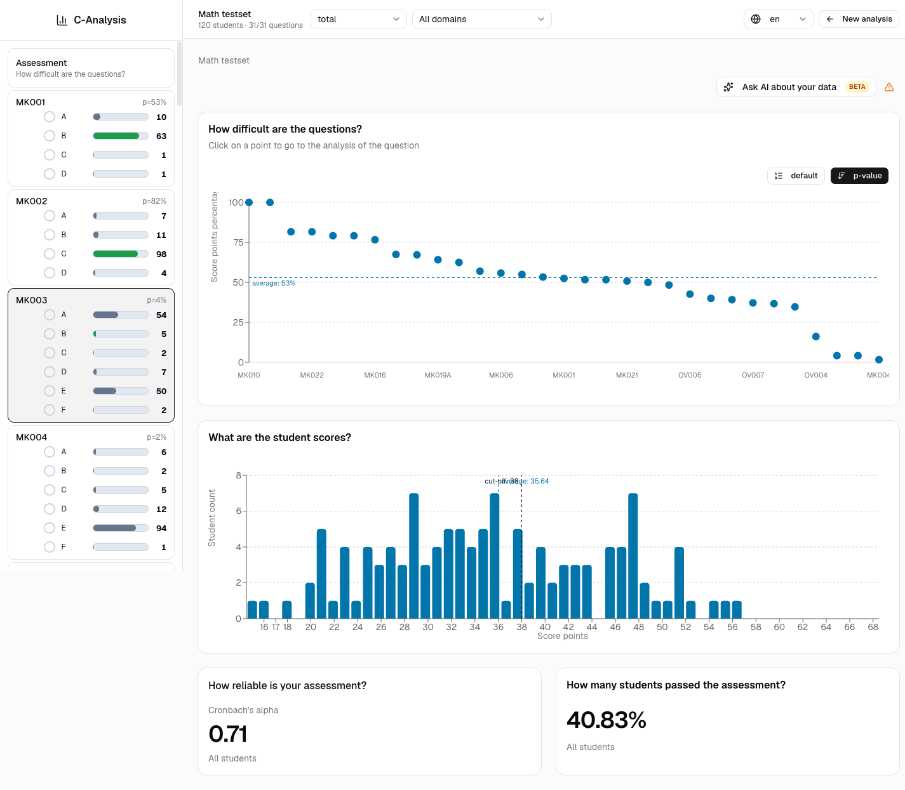
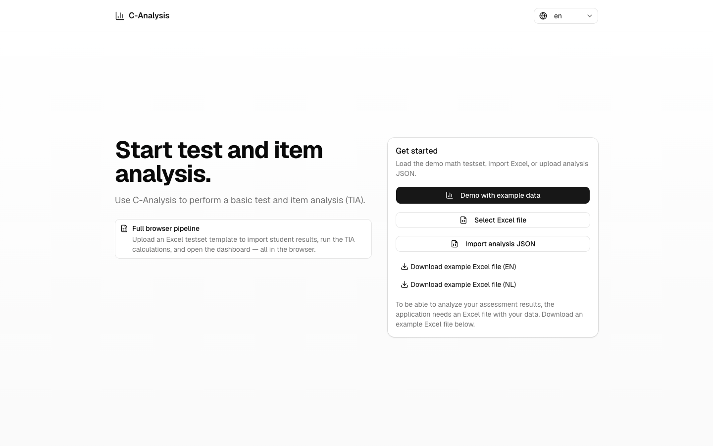
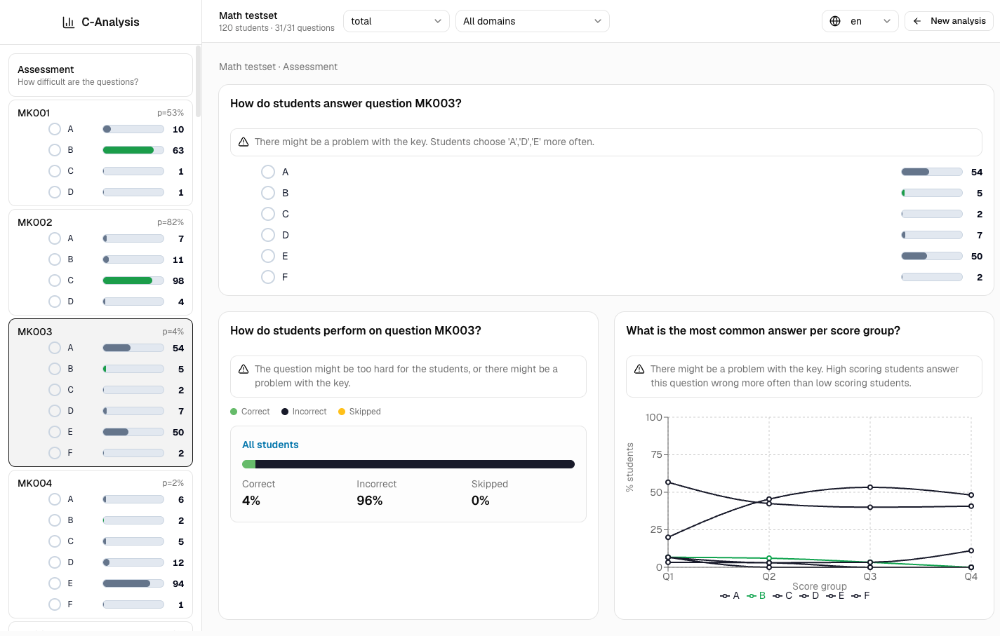

# C-Analysis (demo)

**Test and item analysis (TIA) that runs entirely in your browser.**

C-Analysis helps teachers and test constructors find out how well their assessment
actually worked: which questions were too hard or too easy, which answer keys look
wrong, where distractors misfire, and how reliable the test is as a whole. You give
it your item definitions, answer keys and student results in an Excel file, and it
gives back readable, annotated charts instead of a wall of numbers.

This repository is a browser-only demo/prototype rewrite of the original C-Analysis
application, built by [CitoLab](https://www.cito.nl/kennis-en-innovatie/prototypes/projecten/c-analysis).



## About the project

C-Analysis is a CitoLab prototype. The project page describes it as a tool that shows
which questions are too difficult, too easy or confusing, and gives a clear overview
without requiring complicated interpretation.

The goal is to give teachers *immediate* insight — the tool does not just report
statistics, it interprets them. Where a p-value or an item-rest correlation signals a
problem, C-Analysis writes out what the problem likely is in plain language
("There might be a problem with the key. Students choose 'A','D','E' more often.").

- Project page: **<https://www.cito.nl/kennis-en-innovatie/prototypes/projecten/c-analysis>**
- Live demo: <https://citolab-c-analysis.web.app>

## Everything stays in your browser

There is no backend. No account, no upload, no server-side storage.

Your Excel file is parsed in the browser, the statistics are computed in the browser,
and the analysis is kept in `localStorage` on your own machine. Student results never
leave your device. This matters because assessment data is usually personal data about
minors — the browser-only design means the tool is usable without a data processing
agreement.

The optional AI assistant follows the same rule: it runs a language model locally via
[WebLLM](https://github.com/mlc-ai/web-llm) / WebGPU, so your data is not sent to any
AI provider either.

## Features

**Assessment level**
- P-value plot of all questions, sorted by difficulty, with the test average marked
- Score distribution histogram with cut-off score and mean
- Cronbach's alpha, overall and per domain
- Pass rates, broken down by gender or student group
- Skipped-question analysis

**Item level**
- Response distribution per answer option, with the key highlighted
- Correct / partially correct / incorrect / skipped breakdown
- Distractor plot: which answer each score quartile (Q1–Q4) picks
- Automatic warnings when an item looks broken (bad key, too hard, non-discriminating,
  an option nobody in a group ever chose) — driven by the item-total, item-rest and
  item-alternative correlations (Rit, Rir, Rar) computed under the hood

**Filtering and navigation**
- Split every chart by gender, student group, or domain
- Two independent domain sets (e.g. content domains and reference levels)
- Item navigator sidebar rendering a live QTI preview of each question with the
  response statistics overlaid on the answer options

**Input**
- Excel testset template (English and Dutch), parsed client-side
- Pre-computed analysis JSON import
- A bundled demo dataset (an anonymised 31-question, 120-student math testset)

**Interface**
- English and Dutch
- Local AI assistant (beta) that answers questions about your analysis

## Screenshots

| Start / import | Item analysis |
| --- | --- |
|  |  |

## Getting started

Requires Node.js 20.19+ or 22.12+ (Vite 8).

```bash
npm install
npm run dev
```

Then open the dev server URL and click **Demo with example data** to load the bundled
testset — no file needed.

To analyse your own assessment, download one of the example Excel files from the start
page, fill in your own items and results, and select it with **Select Excel file**.

| Command | What it does |
| --- | --- |
| `npm run dev` | Start the Vite dev server |
| `npm run build` | Type-check and build to `dist/` |
| `npm run preview` | Serve the production build locally |
| `npm test` | Run the Vitest suite |
| `npm run lint` | Run oxlint |

## The Excel template

The template has three sheets:

- **Start** — the name of the analysis, the cut-off score, and settings such as the
  character used for missing values.
- **Test definition** — one row per question: item label, item type (`Multiple choice`
  or `Prescored`), max score, key, number of alternatives, whether it is a calamity
  item, and up to two domain assignments.
- **Student results** — one row per student: identifier, gender, group, and then one
  column per question holding the chosen answer (for multiple choice) or the awarded
  score (for prescored items).

Both an English and a Dutch template are included under
[public/assets/excel/](public/assets/excel/); the importer detects which one you used
from the sheet names.

## Project structure

```
src/
  tia/              Statistics engine — no browser APIs, portable to a backend
    calculator/     p-values, Cronbach's alpha, Rit/Rir/Rar, distributions, distractor plots
    annotator/      Turns statistical outliers into plain-language warnings
    import/         Excel parsing and validation
  qti-stats/        Web components that overlay response stats on a QTI item preview
  lib/local-ai/     WebLLM engine, prompt building, analysis context serialisation
  components/       Charts, cards, layout, shadcn/ui primitives
  pages/            Upload, assessment dashboard, item dashboard
  i18n/             English and Dutch strings
```

The `src/tia` directory is deliberately free of browser and Node APIs, so the same
calculation pipeline can be reused server-side. `runTia(analysis)` runs the full
prepare → calculate → annotate pipeline on a plain object.

## Built with

React 19, TypeScript, Vite, Tailwind CSS, shadcn/ui, Recharts, Zustand, SheetJS,
[@citolab/qti-components](https://github.com/Citolab/qti-components), and
[@mlc-ai/web-llm](https://github.com/mlc-ai/web-llm).

## Deployment

The demo is deployed to Firebase Hosting. Routing is hash-based so the SPA can be
served without server-side rewrites.

```bash
npm run build
npx -y firebase-tools@latest deploy --only hosting:c-analysis
```

## Status

This is a **prototype**, published for reference and reuse. It is not a supported Cito
product. The local AI assistant in particular is experimental: it can misread
statistics or sound more confident than the data warrants, so always check its answers
against the charts.

## License

[MIT](LICENSE) © Stichting Cito Instituut voor Toetsontwikkeling, Arnhem
